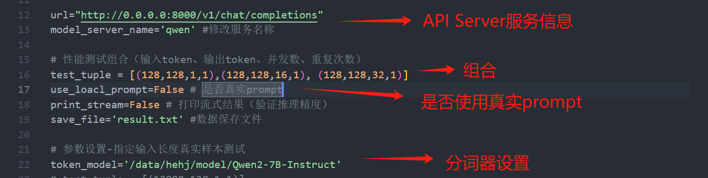
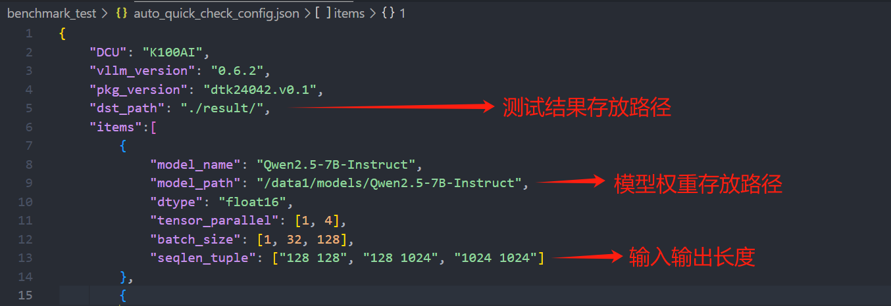

# Benchmark scripts

vLLM 0.6.2 API Server测试的代码/脚本管理

## 更新日志

2025/03/06：更新基于项目来源的api server性能测试脚本，测试项很全面【Scheme-4】（by 刘生同）

2025/01/26：更新基于Scheme-1实现的自动化api server性能测试脚本【Scheme-1plus】（by 刘煦）

2024/12/12：更新基于LLMPerf库的API Server的性能数据测试方法【Scheme-3】（by 高瑞琪）

2024/12/12：更新向API Server发送请求的代码，增加使用真实prompt的功能【Scheme-1】（by 何海君）

2024/12/05：新增基于benchmark_serving代码实现API Server的性能数据测试，分为数据集/固定输入输出两种方法【Scheme-2】（by 孙中谦）

2024/12/04：新增指定输入输出向API Server发送请求的代码，并记录时间戳计算吞吐等指标【Scheme-1】（by 何海君）

## 使用方法

### Scheme 1. 基于发送请求记录时间戳的方法(by 何海君)

0. 进入工作目录：

```
cd ./scheme-1/
```

1. 启动服务端

```
# 举例
python3 -m vllm.entrypoints.openai.api_server --served-model-name qwen2.5-7b --model /data/models/Qwen2.5-7B-Instruct --tensor-parallel-size 1 --dtype float16 --trust-remote-code
```

2. 运行推流脚本（另起窗口）

```
python vllm-chat-api.py
```

3. 输入输出说明

输入参数如图所示，可以按需调整


运行推流脚本后会在当前目录生成record.txt，记录首字延时、Decode吞吐、生成吞吐、总耗时等指标


### Scheme 1plus. 基于Scheme 1实现的api server自动化测试脚本(by 刘煦)

1. 执行测试脚本

```
# 运行测试脚本后会自动启动api server服务，并开始性能测试
bash online_quick_check.sh
```



输出指标：

1. TTFT(s)：首字延时，每条数据求平均值

2. DecodeSpeed(tokens/s)：在decode阶段的处理速度，每条数据求平均；计算方法：speed = output tokens/decode time

3. GenerateThrought(tokens/s)：生成吞吐量，计算方法：throught = output_tokens * concurrency / total_time

4. total_time(s)：总耗时


### Scheme 2. 基于benchmark_serving的性能测试方法(by 孙中谦)

0. 进入工作目录

```
cd ./scheme-2/
```

1. 启动服务端

```
# 举例
python3 -m vllm.entrypoints.openai.api_server --served-model-name qwen2.5-7b --model /data/models/Qwen2.5-7B-Instruct --tensor-parallel-size 1 --dtype float16 --trust-remote-code
```

2. 通过数据集的方式测试API Server性能（另起窗口）

```
# 下载数据集
wget https://huggingface.co/datasets/anon8231489123/ShareGPT_Vicuna_unfiltered/resolve/main/ShareGPT_V3_unfiltered_cleaned_split.json

# 执行测试脚本
bash run_vllm_client_sharegpt.sh
```

3. 固定输入输出，测试API Server性能（另起窗口）

```
# 执行测试脚本
bash run_vllm_client.sh
```

### Scheme 3. 基于LLMPerf库的性能测试方法(by 高瑞琪)

1. 安装LLMPerf库

```
git clone https://github.com/ray-project/llmperf.git
cd llmperf
pip install -e .
```

2. 启动服务端

```
# 举例
python3 -m vllm.entrypoints.openai.api_server --served-model-name qwen2.5-7b --model /data/models/Qwen2.5-7B-Instruct --tensor-parallel-size 1 --dtype float16 --trust-remote-code
```

3. 测试API Server性能（另起窗口）

```
# 执行测试脚本
bash auto_Llama-2-13b-chat-hf.sh
```

### Scheme 4. 基于项目来源的性能测试方法(by 刘生同)

1. 启动服务端

```
# 举例
python3 -m vllm.entrypoints.openai.api_server --served-model-name qwen2.5-7b --model /data/models/Qwen2.5-7B-Instruct --tensor-parallel-size 1 --dtype float16 --trust-remote-code
```

2. 测试API Server性能（另起窗口）

```
# 执行测试脚本
# --benchmark-csv参数控制最终的结果文件
python3 benchmark_parallel.py --backend openai --host 10.17.27.99 --port 8000  --tokenizer /data/model1/modelscope/Qwen2.5-72B-Instruct-AWQ/ --epochs 5  --parallel-num  4 8  --output-tokens 128 256 --prompt-tokens 1024 4096  --benchmark-csv thoughoutput_qwen2.5_72b_awq_vllm0.6.2_4xk100.csv  --served-model-name qwen2_5-72b
```