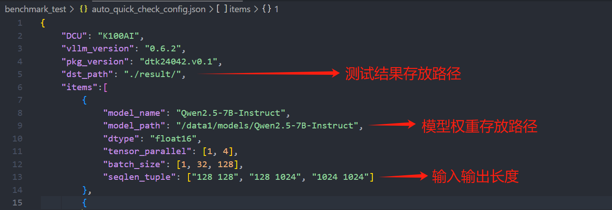

# Benchmark scripts

vLLM 0.6.2 Benchmark测试的代码/脚本管理

## 更新日志

2024/03/12：修复离线测试时重复推理的bug（by 柳啸峰）

2024/12/05：新增测试模型Qwen2.5-32B-Instruct，以及长文本输入的基准性能测试（by 刘煦）

2024/11/26：新增过滤条件，解决某些情况下没有TTFT导致测试终止的问题（by 刘生同）

2024/11/26：更新提升多卡推理性能的环境变量参数（by 刘生同/邵俊杰）

2024/11/19：上传benchmark_test自动化脚本，可以通过json配置文件自动化测试（by 刘煦）

## 使用方法

1. 运行指令：
```
bash auto_quick_check.sh
```
2. 配置文件auto_quick_check_config.json说明



