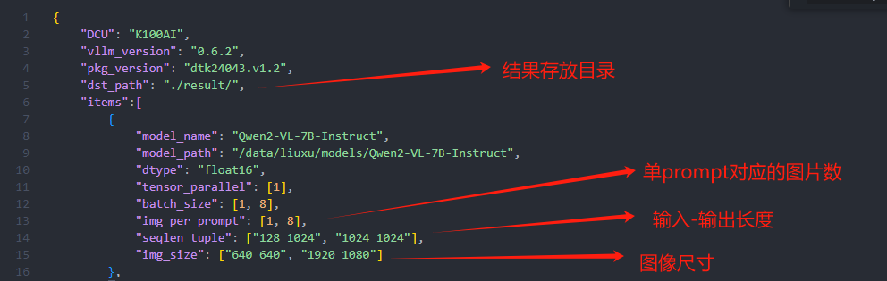

# Benchmark scripts

vLLM 0.6.2 Multimodal多模态模型benchmark测试的代码/脚本管理

## 更新日志

2025/03/26：新增Multimodal多模态模型benchmark测试的自动化测试代码脚本，目前支持qwen2-vl（邵俊杰/李忠涵/刘煦）

## 使用方法

1. 运行指令：
```
bash auto_quick_check.sh
```
2. 配置文件auto_quick_check_config.json说明



3. 结果整合，输出result.xlsx(packages/目录下的结果文件格式)
```
python data_collect.py
```