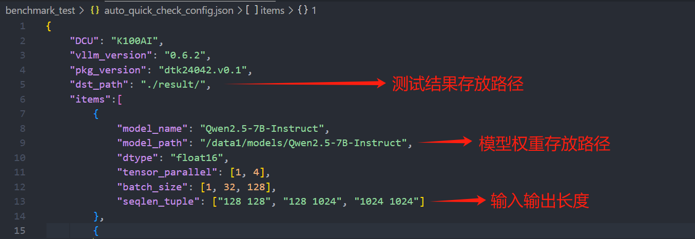
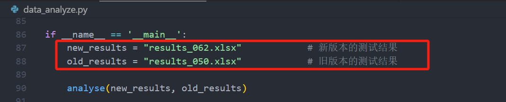
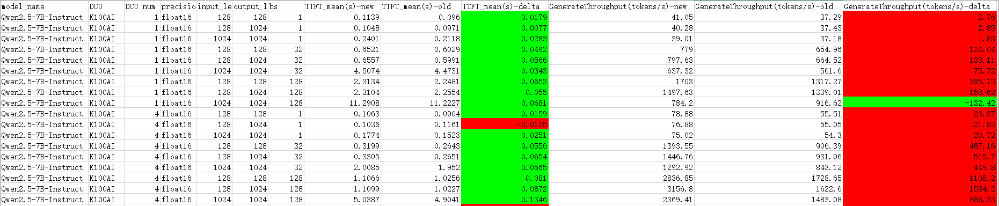
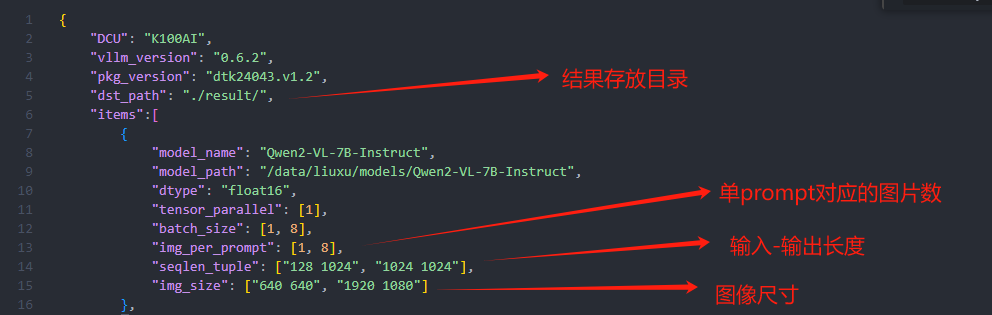

# Quick Check

vLLM性能快速验证的代码/脚本管理

## 更新日志

2025/03/26：新增Multimodal多模态模型benchmark测试的自动化测试代码脚本，目前支持qwen2-vl（邵俊杰/李忠涵/刘煦）

2024/01/26：修改目录结构，新增api server的自动化测试方法；优化长文本输入的测试逻辑（by 刘煦）

2024/12/05：新增测试模型Qwen2.5-32B-Instruct，以及长文本输入的基准性能测试（by 刘煦）

2024/11/26：新增过滤条件，解决某些情况下没有TTFT导致测试终止的问题（by 刘生同）

2024/11/26：更新提升多卡推理性能的环境变量参数（by 刘生同/邵俊杰）

2024/11/19：上传benchmark_test自动化脚本及结果分析脚本，可以通过json配置文件自动化测试（by 刘煦）

## 使用方法——Benchmark Offline

1. 安装依赖：
```
apt-get install jq
pip3 install openpyxl
```

2. 运行自动化测试指令：
```
bash auto_quick_check.sh
```

配置文件auto_quick_check_config.json说明



3. 结果整合，输出result.xlsx(packages/目录下的结果文件格式)
```
python data_collect.py
```

4. 不同版本的结果对比
```
python data_analyze.py
```

代码入口说明



分析结果说明：

如图所示，分别展示了不同版本的性能数据及差距，其中红色表示性能有提升，绿色表示性能有下降



## 使用方法——Apiserver Online

1. 安装依赖：
```
apt-get install jq
pip3 install openpyxl
```

2. 运行自动化测试指令：
```
bash online_quick_check.sh
```

配置文件auto_quick_check_config.json说明


3. 结果整合，输出result.xlsx(packages/目录下的结果文件格式)
```
python data_collect.py
```

输出指标：

1）TTFT(s)：首字延时，每条数据求平均值

2）DecodeSpeed(tokens/s)：在decode阶段的处理速度，每条数据求平均；计算方法：speed = output tokens/decode time

3）GenerateThrought(tokens/s)：生成吞吐量，计算方法：throught = output_tokens * concurrency / total_time

4）total_time(s)：总耗时

## 使用方法——Multimodal Test

1. 运行指令：
```
bash auto_quick_check.sh
```
2. 配置文件auto_quick_check_config.json说明



3. 结果整合，输出result.xlsx(packages/目录下的结果文件格式)
```
python data_collect.py
```